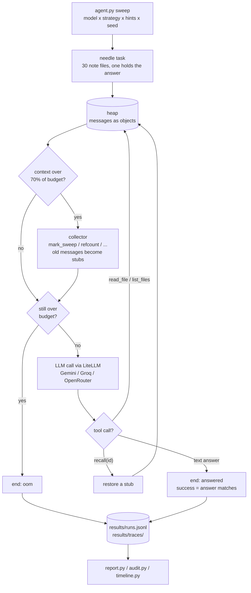
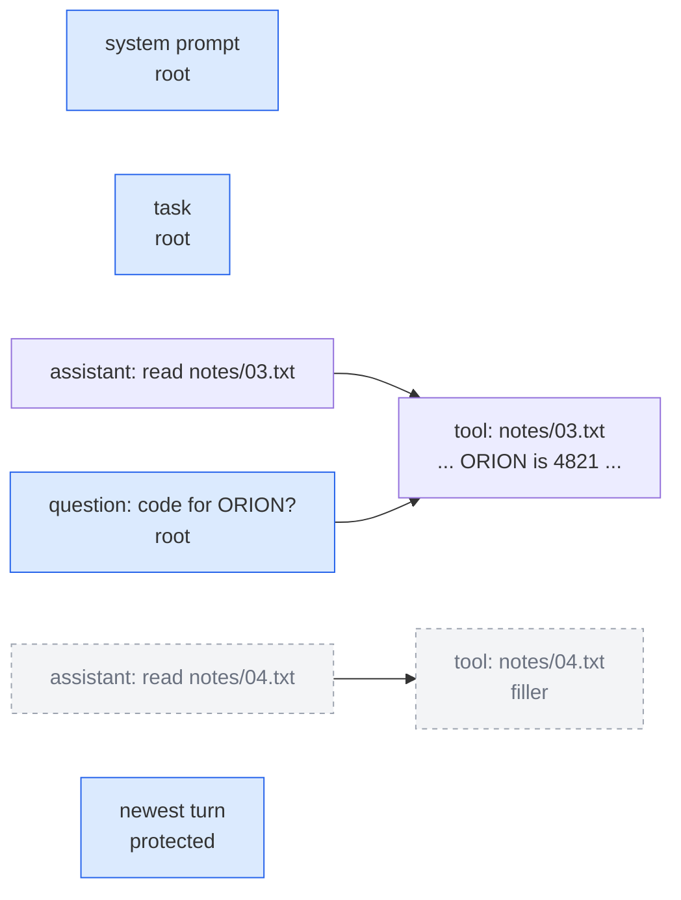

# Context Garbage Collector

What happens when classic garbage-collection algorithms manage an LLM agent's context window?

The context is the heap and each message or tool result is an object. Roots are the system prompt, the task, and the latest turn. References between messages are found with regexes (file paths, CAPS names, numbers). When the context nears a fixed budget, a collector replaces unreachable messages with short stubs such as `[collected: msg 12, read_file a.py]`. The agent has a `recall` tool to bring a stub back, and every recall is logged because a recall means the collector was wrong.

Status: early-stage experiment; results in JOURNAL.md.

## How it works

One run: the agent works through a task while a collector keeps its context under a token budget.



What a collector sees: messages are objects, roots are always kept, and a message is a reference
to an older one when they share a key (file path, CAPS name, 4+ digit number).



Grey = unreachable, so mark-sweep turns it into `[collected: msg N ...; call recall(N) to restore]`.

## Strategies

| Name | Rule |
|---|---|
| `none` | Baseline. Never collect. |
| `truncate` | Baseline. Drop the oldest messages. |
| `lru_mask` | Stub tool outputs not touched in the last N turns. |
| `refcount` | Stub objects with no incoming references from live objects. |
| `mark_sweep` | Stub objects unreachable from the roots. |
| `generational` | Mark-sweep the young generation often. Promote survivors to an old generation that is collected rarely. |
| `oracle` | Knows the answer and keeps only what is needed. Upper bound for the others. |

## Quickstart

```
pip install litellm python-dotenv pandas matplotlib tabulate pytest hypothesis
```

Create a `.env` file with the keys for the providers you use:

```
GEMINI_API_KEY=
OPENROUTER_API_KEY=
GROQ_API_KEY=
```

Run the offline tests, then a small sweep, then the report:

```
python -m pytest -q
python agent.py --models openrouter/nvidia/nemotron-3.5-lightning:free \
    --strategies none,truncate,mark_sweep --triggers threshold:0.7 --seeds 0,1,2 --max-cost 0
python report.py
```

The sweep is resumable: finished cells are skipped. Run `python agent.py --help` for all flags (positions, upfront question, stub hints, budget, number of files, ...). `--max-cost` is a USD cap over everything in `results/runs.jsonl`; the default of 0 blocks paid models.

Inspect runs:
- `timeline.py`: heap timeline plot for one run, `python timeline.py results/traces/<run_id>.json`.
- `audit.py`: checks whether the collector dropped the needle, `python audit.py`.

## What gets recorded

One row per run in `results/runs.jsonl`:
- identity: `run_id`, `ts`, `strategy`, `trigger`, `hints`, `budget`, `task_family`, `task_id`, `provider`, `model`
- outcome: `success`, `end`, `answer`, `turns`
- GC activity: `gc_runs`, `tokens_freed`, `recalls`, `repeated_calls`
- size and cost: `max_context_tokens`, `max_est_tokens`, token counts, `cost_usd`, `wall_s`
- cache behavior: `stable_prefix_share`, `cache_breaks`

Full transcripts and the final heap of each run are in `results/traces/<run_id>.json`. Neither `results/traces/` nor `.env` is committed.

## More

- [SPEC.md](SPEC.md): design, heap model, variables, stack.
- [HYPOTHESES.md](HYPOTHESES.md): what we test, and the roadmap.
- [JOURNAL.md](JOURNAL.md): dated observations.

Prior art:
- [MemGPT](https://arxiv.org/abs/2310.08560)
- [The Complexity Trap](https://arxiv.org/abs/2508.21433)
- [Self-GC](https://arxiv.org/abs/2607.00692)
