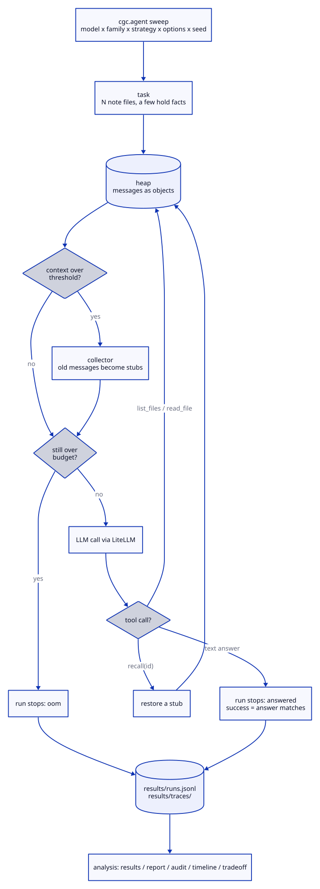
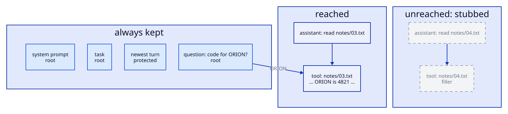

# Context Garbage Collector

What happens when classic garbage-collection algorithms manage an LLM agent's context window?

The context is the heap and each message or tool result is an object. Roots are the system prompt, the task and the newest turn. Two messages reference each other when they share a key: a file path, a CAPS name or a 4+ digit number, found by regex. When the context nears a fixed token budget, a collector replaces messages it thinks are dead with short stubs such as `[collected: msg 12 read_file notes/05.txt — keys: ORION, 4821; call recall(12) to restore]`. The agent can bring a stub back with `recall`, and every recall is logged, because a recall means the collector was wrong.

Status: exploratory experiment. Dated observations are in [docs/JOURNAL.md](docs/JOURNAL.md), the hypotheses and their status in [docs/HYPOTHESES.md](docs/HYPOTHESES.md).

## Findings so far

All numbers below are from one model, `groq/openai/gpt-oss-120b`, with the question asked after the agent has read every file (the hard case), a 16k-token budget and collection at 70% of it. `n` is runs per cell (one run per seed). A single run moves an n=3 cell by 33 points, so treat n=3 cells as hints.

- **The stub decides everything.** With bare stubs every real collector failed the needle task (mark_sweep 0/10, refcount 0/10): the model could not tell which stub held the fact and recalled blindly. Listing the collected message's keys in its stub gave 10/10 for both, with about 35% fewer input tokens and far fewer prompt-cache breaks.
- **Cheap collectors lose on harder tasks.** On multihop (the answer needs two files) and poison (a fact is corrected later), the collectors that keep more context succeed more and cost more: truncate is the expensive, safe end, mark_sweep the cheap, lossy end ([chart](docs/img/tradeoff.png)).
- **Following references did not help.** Mark-sweep did worse than plain LRU masking on multihop (6/10 vs 9/10), and the write barrier did not fix poisoning (3/10).
- **Stale numbers leak through stubs.** Poison failures answered the revoked code because the stub advertised it. Stubs that point at the superseding message, with collected results rendered as one message (`pointer` + coalesce), took mark_sweep and refcount on poison from 2/10 to 10/10.
- **The model is a bad collector of its own memory.** With a `forget` tool and nothing automatic it got 4/30; with a DCP-style `compress` tool, 2/30. Both forgot too little and ran out of memory.
- **Search beats hints for recovery.** A search tool over collected text took bare-stub mark_sweep from 0/10 to 7/10 on needle, and hybrid from 4/10 to 9/10 on poison.
- **Paraphrase is unsolved.** When the question names a description instead of the project, every real collector is at 3-5/10; only the oracle succeeds.

Other models: `gpt-oss-20b` and Qwen 3.8 27B on Groq failed at tool calling in this harness, and the free Gemini and OpenRouter quotas were too small for sweeps, so every result above rests on one model.

## Strategies tested

A strategy decides which messages to stub when the context passes the threshold. Results: successes / runs on gpt-oss-120b with `keys` hints. Families: needle (one file holds the answer), multihop (a link file points to a value file), poison (a later file revokes an earlier fact), paraphrase (the question names the project by description). "—" means not run.

| Strategy | What it does | Idea from | Needle | Multihop | Poison | Paraphrase |
|---|---|---|---|---|---|---|
| `none` | Never collect. Runs out of memory. | Baseline | 0/3 (no hints) | — | — | — |
| `truncate` | Stub the oldest messages until under budget. | Baseline (sliding window, as in [StreamingLLM](https://arxiv.org/abs/2309.17453)) | 10/10 | 9/10 | 6/10 | — |
| `mask` | Stub tool results older than 3 turns. | Observation masking, [The Complexity Trap](https://arxiv.org/abs/2508.21433) | 3/3 | — | — | — |
| `lru_mask` | Stub tool results whose keys no assistant message used in the last 3 turns. | LRU caches; The Complexity Trap | 10/10 | 9/10 | 4/10 | 5/10 |
| `hybrid` | `mask`, then if still over the threshold, summarize the rest with one LLM call. | Masking + summary, The Complexity Trap | 3/3 | — | — | — |
| `refcount` | Stub messages that no live user/assistant message references. | Reference counting (classic GC) | 10/10 | 6/10 | 2/10 | — |
| `mark_sweep` | Walk references from the roots; stub everything unreached. | Mark-sweep (classic GC) | 10/10 | 6/10 | 2/10 | 3/10 |
| `mark_sweep_chain` | Mark-sweep, but small tool results (at most 3 keys) also pass reachability on, so a link file keeps its value file alive. | This project, after the multihop failures | — | 8/10 | 3/10 | — |
| `write_barrier` | Mark-sweep, plus stub a message whose fact (CAPS name + number) a newer message contradicts. | Write barriers (classic GC) | 9/10 | 6/10 | 3/10 | — |
| `generational` | Mark-sweep the young messages each time; survivors are promoted and only swept when memory is tight. | Generational GC (classic GC) | 2/3 | — | — | — |
| `h2o` | Keep the first 2 messages, the newest 2 turns and the 4 most-referenced tool results; stub the rest. | [H2O heavy-hitter KV eviction](https://arxiv.org/abs/2306.14048) | 3/3 | — | — | — |
| `semantic` | Keep the 4 messages whose embeddings are closest to the roots; stub the rest. Needs `GEMINI_API_KEY`. | Query-aware selection ([SnapKV](https://arxiv.org/abs/2404.14469), [Quest](https://arxiv.org/abs/2406.10774)) | 10/10 | — | — | 4/10 |
| `manual` | Collect nothing; the model gets a `forget(ids)` tool and a memory-pressure note. | Self-managed memory, [MemGPT](https://arxiv.org/abs/2310.08560) | 1/10 | 2/10 | 1/10 | — |
| `compress` | Collect nothing; the model gets a `compress(from_id, to_id, summary)` tool that replaces a range of old messages with its own summary (originals stay recallable), and a memory note above 50% of the budget, every 5th call. | [OpenCode DCP plugin](https://github.com/Tarquinen/opencode-dynamic-context-pruning) (compress tool) | 1/10 | 0/10 | 1/10 | — |
| `oracle` | Knows the answer; stubs everything that does not contain it. Upper bound. | This project | 10/10 | 10/10 | 10/10 | 10/10 |

Strategies that are not baselines (`refcount`, `mark_sweep`, `mark_sweep_chain`, `write_barrier`, `generational`, `semantic`) also stub the oldest reachable tool results when the trigger sets a lower target (see `threshold:P:T` below).

## Options tested

These change what a stub carries, how the context is shown to the model, or when collection runs. They combine with any strategy.

| Option | What it does | Idea from | Result |
|---|---|---|---|
| `--hints none` | Bare stub: message id and tool call only. | — | Every real collector 0/3-0/10 on needle. |
| `--hints keys` | Stub lists up to 6 keys of the collected message. | This project (first real run, see journal) | 10/10 on needle; ~35% fewer tokens than `none`. |
| `--hints preview` | Keys plus the first 12 words. | Stub-content ablation, inspired by [LLMLingua](https://arxiv.org/abs/2310.05736) and [ACON](https://arxiv.org/abs/2510.00615) | 3/3, more tokens than keys. |
| `--hints numbers` | Keys plus every 4+ digit number. | Same ablation | 3/3, about the same as keys. |
| `--hints fresh` | Keys, with numbers that a newer fact revoked removed from every stub. | This project, after the poison analysis | No gain on poison (1-3/10). |
| `--hints pointer` | Like `fresh`, and a stale key says which message superseded it: `ORION (superseded by msg 41)`. | This project, after the poison analysis | Poison 6-7/10 alone, 10/10 with coalesce. |
| `--coalesce true` | Render runs of collected (call, stub) pairs as one message listing them. | This project: dozens of stub pairs made the model lose count of what it had read | With `pointer`: poison 10/10, multihop 8-9/10. |
| `--pressure true` | Send a `[memory] context N% of budget` note with each call; never stored. | MemGPT's memory-pressure warnings | Unclear (n=3); helped `manual` (1/6 → 3/6). |
| `--triggers threshold:P:T` | Collect when over P of the budget, then down to T (hysteresis). | Low-water marks in GC; [Don't Break the Cache](https://arxiv.org/abs/2601.06007) | No visible effect on cache breaks (n=3). |
| `--triggers every_turn` | Collect before every model call. | — | Not run on a real model. |
| `--positions` | Where the needle file sits in the reading order. | [Lost in the Middle](https://arxiv.org/abs/2307.03172) | Only 0.5 run so far. |
| `--dedup true` | Stub the older result when a later live `list_files` or `read_file` result came from the same call. | OpenCode DCP plugin (deduplication) | Never fired (n=10 per cell). |
| `--recall tail` | Return a recalled message as the `recall` result at the end of the context (`[recalled msg N] ...`) and leave the stub where it is. | RAMPART (block placement) | Same success as in place (needle 9-10/10, poison 2-3/10); too few recalls to judge. |
| `--upfront true` | Ask the question with the task instead of at the end. | — | Not run on a real model. |

## From other projects

Ideas taken from other context-management work. Each gets its own branch and a hypothesis in [docs/HYPOTHESES.md](docs/HYPOTHESES.md). Built features have no real-model results yet.

| Feature | What it would do | Idea from | Status |
|---|---|---|---|
| `search` tool (`--search true`) | Search the text of collected messages and return up to 5 matching sentences (`msg N: ...`), instead of restoring a whole message with `recall`. Live messages are not searched. | Cursor, "Dynamic context discovery" (long tool output written to files the agent reads in part) | Recovers the needle without stub hints: needle 0/10 → 7/10 with `--hints none`, ~35% fewer tokens; every run that searched succeeded (H25). Poison 2/10 → 6/10, but most successes never searched (H27 unclear). |
| Searchable summaries | Keep the original of the message `hybrid` overwrites with its summary (`archived` in the trace), so search can still reach it. | Cursor, same post (chat history kept as a file after summarization) | `hybrid` + search: multihop 7/10 → 9/10, poison 4/10 → 9/10 at the same token cost (H28). The archived originals themselves rarely matter: the overwritten message is usually an assistant tool call with no text, and the summarized tool results were already searchable. |
| Deduplication | When the same tool is called again with the same arguments, stub the older result. Runs only inside a collection, so it adds no cache breaks. | [OpenCode DCP plugin](https://github.com/Tarquinen/opencode-dynamic-context-pruning) | Never fired: the model did not repeat a call in 40 runs, so H29 is untested on these tasks. |
| `compress` tool | The model picks a range of messages and writes its own summary for them; overlapping summaries nest; a reminder fires every Nth call above a threshold. | OpenCode DCP plugin | As the only collector it fails: 2/30, 28 out of memory; the model compressed too rarely (H30). Not tested alongside automatic collection, as DCP uses it. |
| Recall to the tail | Return recalled content as the `recall` tool result at the end of the context instead of restoring it in place: closer to the question, and the earlier prompt stays cacheable. | RAMPART (placement of blocks matters); Lost in the Middle | No effect: the model recalled in 1-4 of 10 runs, too rarely for placement to matter (H31 unclear). |
| `--hints summary` | Stub carries a one-line, model-written summary of the collected message. | Dynamic Context Loading (Moncef Abboud): model-written tool briefs | Idea |

The DCP plugin is AGPL-3.0; only its ideas are reimplemented here, no code is copied.

## Use it in your own agent

`cgc.context.Context` takes an OpenAI-format message list and returns the one to send, with old messages collected into stubs. Recall and search are tools the model can call. The defaults (`cgc.context.DEFAULTS`) are provisional and will be updated from the sweep results.

```python
from cgc.context import Context

ctx = Context(budget=16000)                      # strategy, trigger, hints, coalesce, search, dedup, recall
messages = [{"role": "system", "content": SYSTEM}, {"role": "user", "content": task}]
while True:
    reply = my_model(ctx.prepare(messages), tools=[*my_tools, *ctx.tools])
    messages.append(reply)                       # the history stays append-only; prepare never edits it
    if not reply.get("tool_calls"):
        break
    for c in reply["tool_calls"]:
        args = json.loads(c["function"]["arguments"])
        result = ctx.call(c["function"]["name"], args) or my_dispatch(c["function"]["name"], args)
        messages.append({"role": "tool", "tool_call_id": c["id"], "content": result})
```

Google ADK (`pip install -e .[adk]`), one collector per process, state kept per session id:

```python
from cgc.adk import Collector

collector = Collector(budget=16000)              # same options as Context
agent = Agent(name="a", model=model, instruction=SYSTEM,
              before_model_callback=collector.before_model,
              tools=[*my_tools, *collector.adk_tools])
```

## How it works

One run: the agent reads a folder of note files while a collector keeps its context under a token budget, then answers a question.



What a collector sees: roots are always kept, the newest turn is protected, and a message is reachable when it shares a key with a reachable user or assistant message.



Grey, dashed = unreachable, so mark-sweep turns it into a stub. Diagram sources are the `.d2` files next to the images; re-render with `d2 --theme=0 --pad=20 --layout=elk <file>.d2 <file>.svg`.

## Running it

```
pip install -e ".[test]"
```

Create a `.env` file with the keys for the providers you use:

```
GEMINI_API_KEY=
OPENROUTER_API_KEY=
GROQ_API_KEY=
```

Run the tests, a small sweep, then the results table:

```
python -m pytest -q
python -m cgc.agent --models groq/openai/gpt-oss-120b --strategies none,truncate,mark_sweep \
    --hints keys --seeds 0,1,2 --max-cost 2
python -m analysis.results
```

Every option above takes a comma list, and the sweep runs every combination. The sweep is resumable: finished cells are skipped. `--max-cost` is a USD cap over everything already in `results/runs.jsonl`; the default of 0 blocks models LiteLLM lists as paid. Groq's free tier is listed as paid, so Groq sweeps need a nonzero cap even though they cost $0. Run `python -m cgc.agent --help` for every flag.

Long sweeps: `scripts/sweep.ps1` starts one as a hidden, detached process that survives the terminal and prints its PID. Quote comma lists in PowerShell, or it splits them into separate arguments.

```
powershell -File scripts/sweep.ps1 -Name sweep3 --models groq/openai/gpt-oss-120b --strategies 'mark_sweep,refcount' --hints 'none,keys' --tag sweep3
```

Output goes to `results/<Name>.log` and `results/<Name>.err`; stop it with `Stop-Process -Id <PID>`. Watch progress at http://localhost:8000/analysis/dashboard.html after `python -m http.server 8000` from the repo root.

Analysis:
- `python -m analysis.results` regenerates [docs/RESULTS.md](docs/RESULTS.md) (experiments and results per cell).
- `python -m analysis.report` prints a table and plots success against tokens.
- `python -m analysis.audit` says, per run, whether the needle was collected and recalled.
- `python -m analysis.timeline results/traces/<run_id>.json` plots one run's heap over time.
- `python -m analysis.tradeoff results/runs.jsonl` draws the cost-vs-accuracy chart.

## Tests

The tests are end to end. They start a local OpenAI-compatible server backed by a scripted agent, run the real sweep CLI against it in a subprocess, and check the files it writes and the output of the analysis scripts. No API keys or network access are needed.

## What gets recorded

One row per run in `results/runs.jsonl`:
- identity: `run_id`, `ts`, `strategy`, `trigger`, `hints`, `pressure`, `coalesce`, `search`, `dedup`, `recall`, `tag`, `budget`, `task_family`, `task_id`, `provider`, `model`
- outcome: `success`, `end` (`answered`, `max_turns`, `oom` or `api_error`), `answer`, `turns`, `error` (exception type and first 300 chars of the message for `api_error`, API keys redacted)
- GC activity: `gc_runs`, `tokens_freed`, `recalls`, `searches`, `dedups` (messages collected by `--dedup`), `forgets`, `compressions` (successful `compress` calls), `compressed_msgs` (messages they replaced), `summary_calls`, `embed_calls`, `repeated_calls`, `unknown_tool_calls`
- size and cost: `max_context_tokens`, `max_est_tokens`, `input_tokens`, `cached_input_tokens`, `output_tokens`, `cost_usd`, `wall_s`
- cache behaviour: `stable_prefix_share` (share of each prompt identical to the previous one), `cache_breaks`
- computed by the analysis, not stored: `excess_tokens`, prompt tokens per turn above the oracle run on the same task

Full transcripts and the final heap of each run are in `results/traces/<run_id>.json`. Neither `results/` nor `.env` is committed.

## More

- [SPEC.md](docs/SPEC.md): design, heap model, variables, stack.
- [HYPOTHESES.md](docs/HYPOTHESES.md): what is tested, status of each hypothesis, roadmap.
- [JOURNAL.md](docs/JOURNAL.md): dated observations per sweep.
- [RELATED_WORK.md](docs/RELATED_WORK.md): papers and how they map onto this project.
- [RESULTS.md](docs/RESULTS.md): generated table of every cell.

Closest prior art: [MemGPT](https://arxiv.org/abs/2310.08560), [The Complexity Trap](https://arxiv.org/abs/2508.21433), [Self-GC](https://arxiv.org/abs/2607.00692).
