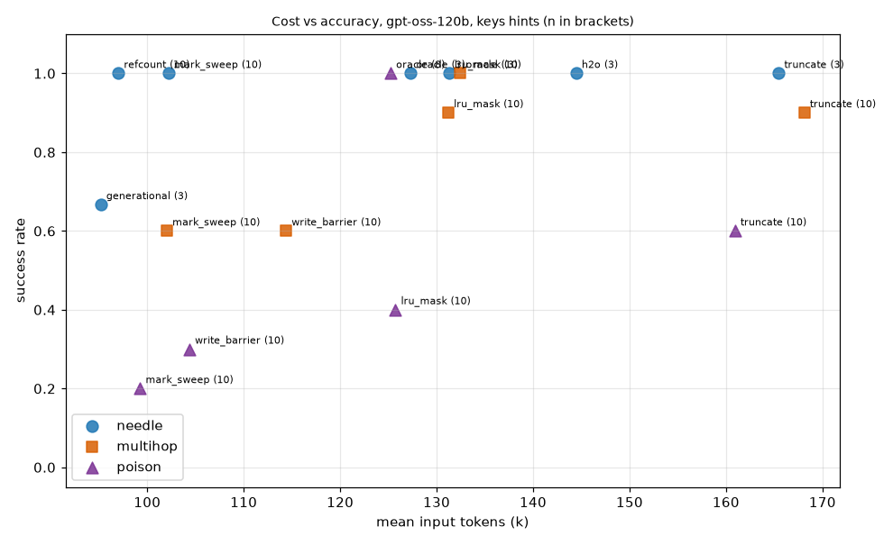

# Journal

## 2026-11-13 — first real run
Nemotron 3.5 Lightning (free), mark_sweep, needle in the middle, question asked late.
- GC ran twice: context 11.5k → 2.2k tokens. Pipeline works end to end.
- Wrong answer. After the question the model recalled only 2 of ~25 stubs, then said "not found".
- Stubs only say `read_file notes/12.txt`, so the model can't tell which stub holds the fact.
- Idea: add a short hint to each stub (first words, or key names like ORION) and test it as a variant.

## 2026-11-13 — sweep 2, Groq gpt-oss-120b: stub hints decide everything
Needle task, question asked late, 3 seeds, budget 16k, threshold 0.7.
- Without hints every real collector failed (0/3 each); the model recalled blindly (12–25 recalls) and lost the needle.
- With hints (stub lists the keys it held) mark_sweep, refcount, lru_mask, truncate went 3/3; generational 2/3. Oracle 3/3 either way.
- Hints also halved tokens (mark_sweep 181k → 107k) and cut cache breaks from 14–27 to 2–6.
- Cheapest successful collector: refcount + hints (93k input tokens, below the oracle's ~126k — the oracle keeps the needle but the agent still reads every file).
- Caveat: n=3 per cell, one model. Need Gemini/Nemotron and more seeds.

## 2026-11-14 — sweep 3 (Groq gpt-oss-120b, n=2–3 per cell)
All cells n=3 (sweep 3) unless noted; one flipped run moves a cell by 33 points, so noise is as large as most effects below. Sweep 4 (10 seeds) is running; treat all of this as hints, not results. Baselines (sweep 2, keys, 0.7): mark_sweep 3/3 at ~107k input tokens, refcount 3/3 at ~93k.
- Stub modes (H18): hints=none failed everywhere that was tried (h2o 0/3, 208k tokens, 16 cache breaks, 13 recalls). keys, preview and numbers all went 3/3 for h2o, mark_sweep and refcount. Tokens: mark_sweep keys ~107k, numbers 111k, preview 129k; refcount numbers 103k, preview 117k. Previews cost tokens and add no success. Keys (or numbers) look sufficient.
- h2o (H20): 3/3 with keys at 144k tokens, 4.7 cache breaks. It succeeds but sits with mask/hybrid (~140–146k), well above mark_sweep (~107k, 93k with pressure). No graph walk costs ~35% more tokens.
- Hysteresis (H19): threshold:0.7:0.4 vs 0.7 changed nothing visible. mark_sweep (pressure) 3/3 at 95–96k vs 93k, cache breaks 2.7–3.0 vs 2.7; mask/hybrid 3/3 at 138–145k, breaks 4.0–4.7 either way. No cache-break reduction seen.
- Manual forget (H13): worst strategy. 1/6 without pressure (5 oom), 3/6 with (3 oom); 6–12 forgets per run. The model forgets too little and runs out of context.
- Pressure note (H14): mark_sweep 3/3 either way, ~94k vs ~107k tokens (possibly fewer recalls, 0.8 vs 2.3). mask and hybrid unchanged (3/3 both, 134–142k). manual improved 1/6 → 3/6 (n=6 pooled over hysteresis). Unclear.
- Mask / hybrid baseline (H15): mask 6/6 and hybrid 6/6 with keys, but at 135–146k tokens (vs ~107k mark_sweep); summary_calls add cost for hybrid. As good on success, more tokens.
- Multihop (H11, pooled sweeps 3+4 so far): mark_sweep 4/6, write_barrier 5/6, lru_mask 4/5, truncate 5/5 (167k tokens, ~2x mark_sweep's 89k), oracle 3/3. No sign that mark_sweep follows chains better than lru_mask or truncate.
- Multihop investigation (mark_sweep 1/3 vs write_barrier 3/3 in sweep 3): verdict is noise, not the referencer rule.
  - The 2 failures were model-side: run 3a2f80581c34 (seed 0) said DONE at turn 15 after reading 14 of 30 files and never read the link file, then answered "I don't have the code"; the same seed under write_barrier went on to succeed (c0d8d64f316c). Run 44a11acb52d1 (seed 2) recalled nothing and returned an empty final message (turn 33, 2032 output tokens); its value file (msg 59) was never collected. lru_mask ea0b7b501c6d failed the same way.
  - The same early-DONE failure hit write_barrier in sweep 4 (6aae544e48d3, seed 3), so the strategies behave alike. Where mark_sweep succeeded (2d70d9803187) both link (msg 35) and value (msg 37) were collected at turn 26 and the model recalled both.
  - The chain is cut by design: an offline check (heap with a root saying ORION, a link tool result, a VEGA tool result) keeps the link but collects the VEGA file, because tool results are not referencers. In the real runs it did not matter: the question is asked late, so no root mentions ORION during GC and both files are lost together; recall rescues them via the stub keys. The cut would matter for an upfront question. Not tested (`multihop` runs are all `late`).
  - Could not view the timeline PNGs (rendered to cgc-sweep3-out) in this session; findings come from the traces.
- Poison / write barrier (H12): write_barrier 2/3 (117k) equals mark_sweep 2/3 (110k) and lru_mask 2/3; truncate and oracle 3/3. No evidence the barrier helps.

## 2026-11-14 — sweep 4 (10 seeds): hints confirmed, a cost-vs-accuracy trade-off
gpt-oss-120b, threshold 0.7, no pressure, budget 16k, all tags pooled, n=10 per cell.
- Hints (H17, H4): needle with keys hints mark_sweep 10/10 and refcount 10/10; with no hints 0/10 and 0/10. Keys also cut input tokens (mark_sweep 102k vs 165k, refcount 97k vs 141k, about 35%) and cache breaks (2.3 vs 11.5, 2.2 vs 7.3).
- Multihop (H11 contradicted, keys): lru_mask 9/10, truncate 9/10, mark_sweep 6/10, write_barrier 6/10, oracle 10/10. Following reference chains did not help; mark_sweep is worse.
- Poison (H12 rejected, keys): truncate 6/10, lru_mask 4/10, write_barrier 3/10, mark_sweep 2/10, oracle 6/6. All 25 failures I checked answered the revoked code (rebuilt from the seed with `poison_task`), not noise.
  - write_barrier, 7 failures (position 0.5, late question; stale fact in notes/15 = msg 35, read at turn 17, always collected at the GC at turn 26):
    - Correction never read (12b9e56982b9 s1, 5401a15926da s3, 8df18305271b s9): the agent stopped after 24-25 of 30 files, so the barrier had nothing newer to compare against. Models then recalled the stale msg 35 (turn 28; turns 27-28) and answered it.
    - Correction read early and collected together with the stale fact at turn 26 (f9e7a4647f87 s4: msg 39 read turn 19; 7ac884a9cf4d s6: msg 37 turn 18; 0857efad43bf s7 and a1ba8ff154d1 s8: msg 39 turn 19). The barrier did kill the stale msg, but with a late question nothing references ORION, so mark_sweep collects the correction in the same run. Both end as stubs. s4 and s6 recalled the stale msg 35 and answered it. s7 and s8 made no recall at all: the stub keys read `7468, ORION` and `1791, 7468, ORION`, so the revoked number leaks through the hint and the model picked it.
  - Successes (4dbdf568b967, 164eb64949c1, 8b623f35a721) are runs where the correction file was read after the turn-26 GC (turns 25-30), so it was still live at the question.
  - Why the barrier did not help: it only helps if the stale message goes and the correction stays. Here both are collected together, and the stub hints advertise the stale number (and the correction's stub lists both numbers without saying which is current). The write barrier acts at GC time, but the failure is at recall time.
- Trade-off (H21): collectors that keep more succeed more on the harder tasks and cost more. mark_sweep is the cheap, lossy end (~100k tokens, 6/10 multihop, 2/10 poison); truncate is the expensive, safe end (~165k, 9/10 and 6/10); lru_mask sits between (~130k). Oracle is the ceiling (~125-132k, 100%). On needle everything with hints succeeds, so cost alone separates them and mark_sweep/refcount win.

- Qwen 3.8 27B (groq): almost all runs end in api_error "tool call validation failed", so the model is unusable in this harness. That is not a GC result.
- Loader fix: `analysis.report.load` coerced `hints="none"` to True; RESULTS.md now keeps hint modes as strings.
- Next: chain-reference fix for mark-sweep (in progress), gpt-oss-20b replication (running).
