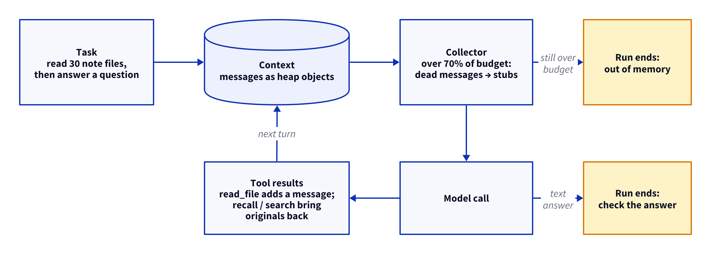
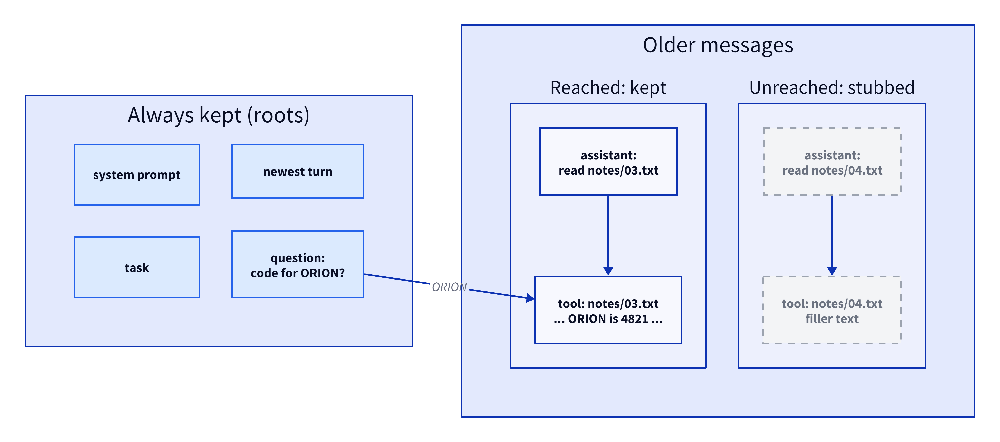
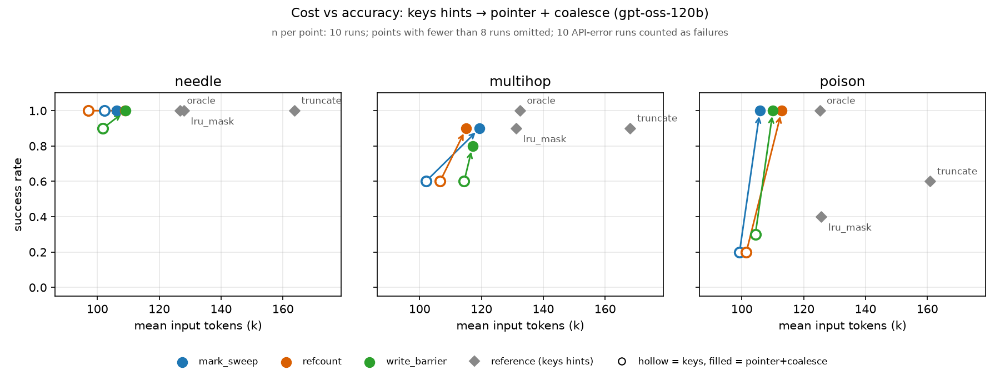
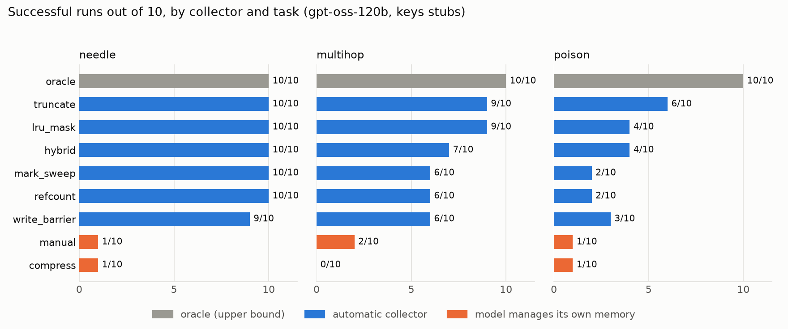
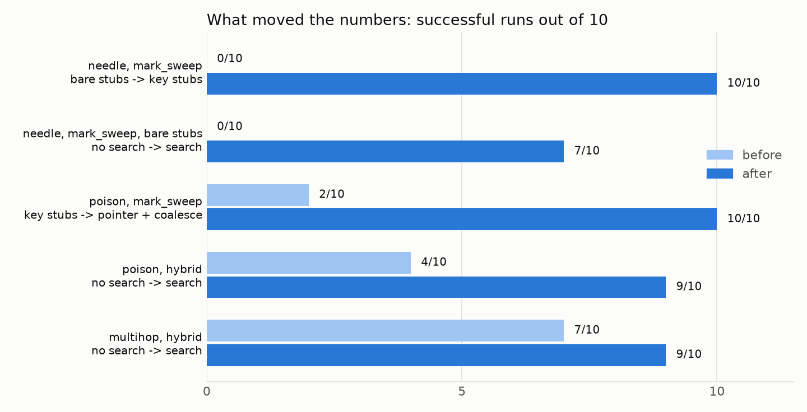

# I Treated an AI Agent's Context Window Like a Garbage-Collected Heap. Here's What Survived.

*I tested 14 context collectors on one model, 680 runs in total. The thing that decided the outcome was not the algorithm. It was what I left behind in place of the deleted text.*

Every agent that works long enough hits the same wall. The context fills up, and something has to go.

Most teams answer with a sliding window or a summary. I wanted to try something older. Programming languages solved "what can I throw away?" decades ago: reference counting, mark-and-sweep, generational collection, write barriers. So I built a small harness and asked a plain question. **If the context is the heap, which garbage collector keeps an agent working?**

This is the report. Some ideas worked, many did not, and one idea I borrowed never even fired.

One caveat up front, because it matters for everything below: **every number here comes from one model**, `gpt-oss-120b` on Groq. I tried `gpt-oss-20b` and a Qwen 27B model, but both failed at tool calling in my harness, and the free Gemini and OpenRouter quotas were too small for sweeps. Treat this as a map of one territory, not a law.

## The setup

An agent reads a folder of 30 note files, one tool call per file, under a **16k-token budget**. Reading all 30 files costs far more than that, so a collector has to run. When the context passes 70% of the budget, the collector replaces messages it thinks are dead with short **stubs**:

```
[collected: msg 12 read_file notes/05.txt — keys: ORION, 4821; call recall(12) to restore]
```

The agent can bring a stub back with a `recall` tool. I log every recall, because a recall means the collector was wrong.

The heap model is simple. Each message is an object. Roots are the system prompt, the task and the newest turn. Two messages reference each other when they share a key: a file path, a CAPS name or a number with four or more digits, found by regex. Mark-sweep walks from the roots and stubs everything it cannot reach.





After the agent has read every file, it gets a question. That is the hard case: nothing in the live context points at the answer. There are four task families:

- **needle**: one file holds the answer.
- **multihop**: a link file points to the file with the value.
- **poison**: a later file revokes an earlier fact, so the old value is wrong.
- **paraphrase**: the question names the project by a description instead of by name.

I compared 14 collectors, from baselines (truncate, LRU masking) through the classic GC ideas (refcount, mark-sweep, write barrier, generational) to a few borrowed from papers. An **oracle** that knows the answer and keeps only that file is the upper bound. Each cell below is 10 runs (n=10), one per seed, unless I say otherwise. One run moves a 10-run cell by 10 points, so I only call something a result when the gap is big.

## Finding 1: the stub decides everything

My first real run failed. The collector worked, the context dropped from 11.5k to 2.2k tokens, and then the model said "not found". The stubs only said `read_file notes/12.txt`. With 25 identical-looking stubs, the model could not tell which one held the fact. It recalled blindly.

So I added the keys of the collected message to each stub. Then I measured it:

- **Bare stubs:** mark_sweep 0/10 and refcount 0/10 on needle.
- **Key stubs:** 10/10 for both, with about 35% fewer input tokens and far fewer prompt-cache breaks.

Same collectors, same budget, same model. One line of metadata turned 0% into 100%. The collector's algorithm mattered far less than what it left behind.

## Finding 2: there is a cost and accuracy trade-off

On needle, everything with key stubs succeeds, so cost alone separates the collectors. On harder tasks there is a real trade-off. The collectors that keep more context succeed more and cost more.



- `truncate` is the expensive, safe end: around 165k input tokens, 9/10 on multihop and 6/10 on poison.
- `mark_sweep` is the cheap, lossy end: around 100k tokens, 6/10 on multihop and 2/10 on poison.
- `lru_mask`, which stubs tool results whose keys no recent message used, sits between them.



The part I did not expect: **following references did not help.** I assumed reachability, the thing that makes a GC a GC, would keep the link file and the value file together on multihop. Mark-sweep did worse than plain LRU masking, 6/10 against 9/10. The write barrier, which stubs a message when a newer one contradicts it, did not fix poisoning either (3/10).

I went through the multihop failures in the traces. Several were on the model's side: it said DONE after reading 14 of 30 files, or returned an empty answer. Some of what looks like a collector failure is the agent stopping early.

## Finding 3: pointer stubs plus coalescing fixed poison

On poison, the failures were consistent. Of the 25 failures I checked, every one answered with the *revoked* code. The stub had advertised it: the stub for the old file listed the stale number as a key, so the model saw it and used it.

The fix has two parts:

- **`pointer` hints:** a stale key says which message superseded it, like `ORION (superseded by msg 41)`.
- **Coalescing:** runs of collected (call, stub) pairs are rendered as one message. I added this because dozens of stub pairs made the model lose count of what it had read.

Together they took mark_sweep and refcount on poison from **2/10 to 10/10**. Pointer alone got 6-7/10, so the coalescing was doing real work. It fits the first finding: poison is a stub-content problem, not a graph problem.

## Finding 4: the model is a bad manager of its own memory

The obvious objection: why build a collector at all? Give the model a tool and let it manage its own context. I tested two versions.

- **`manual`:** a `forget(ids)` tool and a memory-pressure note. It solved **4 of 30** runs across needle, multihop and poison.
- **`compress`:** the idea from the OpenCode DCP plugin. The model picks a range of messages and writes its own summary. It solved **2 of 30**, and 28 of the runs ran out of memory.

In both cases the model forgot too little, too late. The weakness these tools lean on is the one the model has: noticing that it is about to run out.

One honest limit: DCP uses `compress` alongside automatic pruning, and I tested it as the *only* collector. So this says "a model alone can't do it", not "DCP's idea is bad".

## Finding 5: search beats hints for recovery

If the model cannot manage memory, can it at least find what was collected? I added a `search` tool that scans the text of collected messages and returns up to five matching sentences. The idea comes from [Cursor's "Dynamic context discovery"](https://cursor.com/blog/dynamic-context-discovery), where long tool output goes to files the agent reads in pieces.



With bare stubs, which scored 0/10 on needle, search got **7/10**. Every run that searched succeeded, and all three that did not search failed. It cost about the same tokens as key stubs (roughly 104k against 102k per run), so it does not beat keys on price, but it recovers the fact without anyone writing hints.

It also rescued a weak strategy. `hybrid` masks old results and then summarizes the rest with one LLM call, and the summary is lossy. Keep the overwritten originals searchable and hybrid goes **4/10 to 9/10 on poison** and 7/10 to 9/10 on multihop, at the same token cost.

Now the H27 caveat, because I should not oversell this. On poison with mark_sweep, search moved success from 2/10 to 6/10. But four of those six successes never called search. Something else changed in those runs and I cannot tell what. For hybrid the picture is cleaner: search was used in 8 of 10 runs. I call the mark_sweep poison result unclear.

## Finding 6: paraphrase is still unsolved

When the question names a description of the project instead of its name, nothing I built works. Every real collector sits at 3-5/10, including a `semantic` collector that keeps the messages whose embeddings are closest to the question (4/10). Only the oracle gets 10/10.

All my liveness signals are lexical. If the question does not share a key with the file, there is nothing to follow. I do not have a fix.

## What I borrowed, and from whom

Most of what I tried came from somewhere else. The most useful idea here came from outside the GC tradition.

- **[Cursor, Dynamic context discovery](https://cursor.com/blog/dynamic-context-discovery):** the `search` tool, and keeping summarized originals searchable.
- **[OpenCode DCP plugin](https://github.com/Tarquinen/opencode-dynamic-context-pruning):** the `compress` tool and deduplication. The plugin is AGPL-3.0, so I reimplemented only the ideas and copied no code.
- **RAMPART:** returning recalled content at the tail of the context, near the question, instead of restoring it in place.
- **[MemGPT](https://arxiv.org/abs/2310.08560):** `recall` as page-in, `manual` as self-managed memory, and the memory-pressure note.
- **[The Complexity Trap](https://arxiv.org/abs/2508.21433):** observation masking and the masking-plus-summary hybrid.
- **[Lost in the Middle](https://arxiv.org/abs/2307.03172):** the needle-position sweep. I have only a half-run of it so far.
- **[Don't Break the Cache](https://arxiv.org/abs/2601.06007):** the low-water-mark trigger (collect at 70%, down to 40%). I saw no visible effect on cache breaks at n=3.
- **[H2O](https://arxiv.org/abs/2306.14048), [SnapKV](https://arxiv.org/abs/2404.14469), [StreamingLLM](https://arxiv.org/abs/2309.17453):** the `h2o`, `semantic` and `truncate` collectors. These are KV-cache ideas applied to messages instead of tokens.
- **[Self-GC](https://arxiv.org/abs/2607.00692):** the closest prior art, with the same heap view and a planner that proposes what to fold.

## What didn't work

- **Dedup never fired.** I implemented the DCP-style rule that stubs the older result when the same tool call repeats. In 40 runs the model never repeated a call. My tasks do not exercise it, so that hypothesis is **untested**, not rejected.
- **Tail recall was inconclusive.** Success matched in-place recall (needle 9-10/10, poison 2-3/10), but the model recalled in only 1 to 4 runs out of 10. Too few recalls to say whether placement matters.
- **Hysteresis did nothing visible.** Collecting down to a lower water mark did not reduce cache breaks (n=3).
- **Following references.** Covered above. It is a negative result for the idea that gave the project its name.

## What I'd use in practice

If you run an agent like this, here is what I would take from the experiment:

1. **Spend your effort on the stub.** Put the keys of the collected result in it. If a later message supersedes a fact, say so in the stub.
2. **Render collected runs as one message.** With pointer stubs it took cheap collectors to 10/10 on poison.
3. **Pick a cheap collector with those two fixes.** `mark_sweep` with pointer stubs and coalescing scored 10/10 on needle and poison and 9/10 on multihop, at roughly 106k to 119k input tokens per run, against about 165k for `truncate`.
4. **Add a `search` over what you collected.** It is cheap insurance when your stubs are not perfect.
5. **Collect automatically.** Do not rely on the model to call `forget` or `compress`.
6. **Keep an oracle in your evals.** Without a run that knows the answer, I could not have told which failures were mine.

## The takeaway

I went looking for a collector that would beat a sliding window. What I found is that the window was never the whole problem. Every collector throws something away, and what separates a working agent from a lost one is whether it can tell *what* was thrown away and how to get it back.

The code, the hypotheses, the dated journal and every result table are in the repo: **[github.com/ser888gio/context-garbage-collector](https://github.com/ser888gio/context-garbage-collector)**. It is an exploratory experiment, so if you rerun it on another model, I would like to know what you get.
